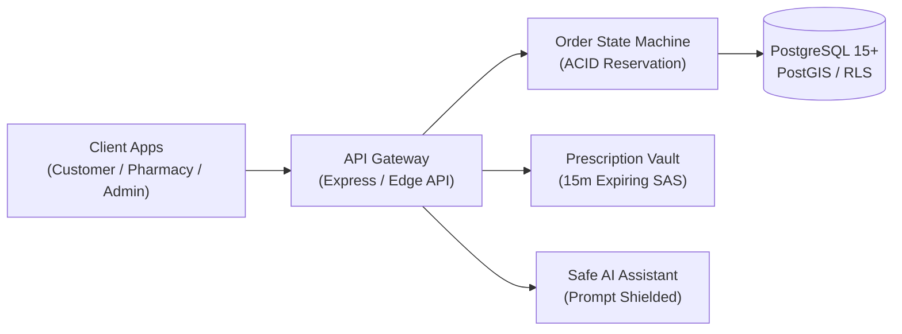

# Medcure 🏥🐾
> **Blinkit-Style Human and Veterinary Quick-Commerce Medicine Delivery Platform**  
> *Target Pilot City: Gorakhpur, Uttar Pradesh, India*

[](LICENSE)
[](https://www.typescriptlang.org/)
[](https://reactjs.org/)
[](https://expressjs.com/)
[](https://flutter.dev/)
[](docs/ARCHITECTURE_AND_SPECIFICATION.md)

---

## 🌟 Overview

Medcure is a hyper-local, quick-commerce healthcare delivery platform designed to serve both **Human Healthcare** and **Animal Healthcare (Veterinary)** in **Gorakhpur, Uttar Pradesh, India**. 

The platform operates on a **zero-warehouse partner model**—aggregating licensed retail pharmacies under the Drugs & Cosmetics Act 1940, coordinating prescription verification by registered pharmacists, batch-level inventory reservation, and last-mile delivery with recipient OTP verification.

Designed with a modern **Claymorphism** UI design system for tactile, accessible, and friendly interaction.

---

## 🏗️ System Architecture



---

## 🚀 Key Features

* **Dual Healthcare Separation:** Independent taxonomies and safety workflows for human medicines and veterinary products (including species suitability and livestock withdrawal period warnings).
* **Server-Enforced RBAC:** Role-based access control for Customers, Pharmacy Owners, Dispensing Pharmacists, Pharmacy Staff, Riders, and Platform Admins.
* **Prescription Review Workflow:** Schedule H and restricted medicines cannot bypass human pharmacist verification. Council registration numbers are recorded for every approval.
* **Claymorphic Design System:** Tactile 3D surfaces, pillowy shadows, and bouncy micro-interactions.
* **Controlled AI Assistant:** Grounded catalogue search and order tracking with safety guardrails that block unauthorized medical diagnoses or dosage calculations.
* **Batch & Handover Integrity:** Batch-level tracking and 4-digit customer delivery OTP handshakes.

---

## 📁 Repository Structure

```
Medcure/
├── backend/                  # REST API Gateway & Business Engine
│   ├── migrations/           # PostgreSQL DDL & Gorakhpur pilot seed data
│   ├── src/
│   │   ├── services/         # Order state machine & AI assistant
│   │   ├── routes/           # REST endpoints (/api/v1)
│   │   ├── store.ts          # Seeded transactional in-memory data store
│   │   └── __tests__/        # Automated integration test suite
│   └── .env.example          # Environment configuration template
├── web/                      # React 18 + Vite + TypeScript Web Application
│   ├── src/
│   │   ├── App.tsx           # Customer Store, Pharmacy Portal & Admin Station
│   │   └── index.css         # Claymorphism design system tokens
│   └── vite.config.ts
├── mobile/                   # Flutter Mobile Codebase (Android & iOS)
│   ├── lib/                  # Screens, models, and HTTP client
│   └── pubspec.yaml
└── docs/
    └── ARCHITECTURE_AND_SPECIFICATION.md   # Complete system architecture & schema
```

---

## 🛠️ Quick Start

### 1. Start the Backend API Gateway
```bash
cd backend
npm install
npm run dev
# Server runs on http://localhost:4000/api/v1
```

### 2. Run Backend Tests
```bash
cd backend
npm test
```

### 3. Start the Web Portal (Claymorphic UI)
```bash
cd web
npm install
npm run dev
# Open http://localhost:3000 (or http://localhost:3001) in your browser
```

---

## 📜 Compliance & Legal Notice

*All partner pharmacies are independently verified and licensed under the Uttar Pradesh Food Safety & Drug Administration. Prescription dispensing is performed exclusively by registered pharmacists holding valid State Pharmacy Council credentials.*
