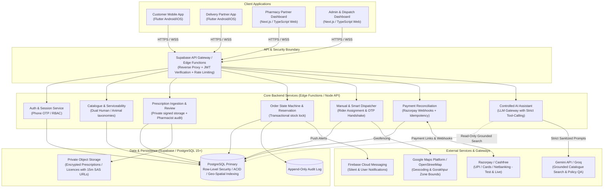
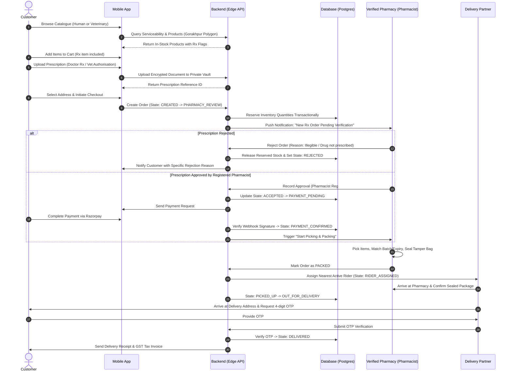
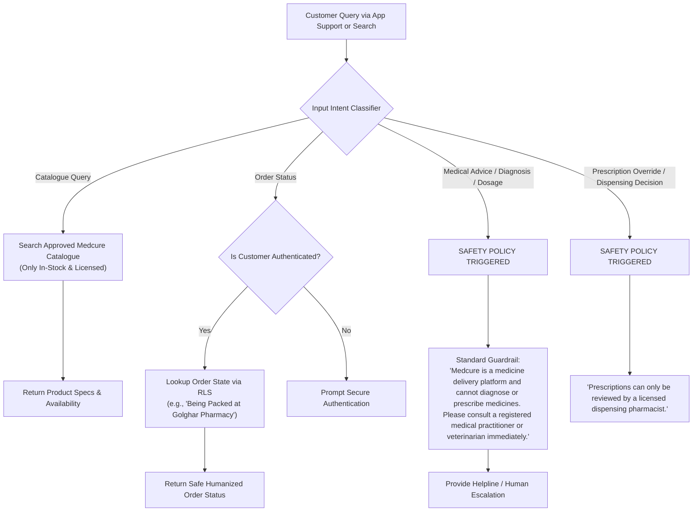

# Medcure: Master Architecture & Product Specification
**Blinkit-Style Human and Veterinary Quick-Commerce Medicine Delivery Platform**
*Target Pilot City: Gorakhpur, Uttar Pradesh, India*

---

## 1. System Architecture Diagram



---

## 2. Complete Screen Inventory

### A. Customer Mobile App (Flutter)
| # | Screen Identifier | Title | Core Functions & Elements |
|---|---|---|---|
| **C-01** | `SplashOnboardingView` | Welcome & City Selection | Medcure branding, service overview, Gorakhpur pilot scope, language switcher (Hindi/English), permissions rationale (Location/Notification). |
| **C-02** | `AuthPhoneOtpView` | Login & Profile Setup | 10-digit Indian phone number entry, SMS OTP input (auto-read), session restoration, user full name & emergency contact profile. |
| **C-03** | `LocationServiceabilityView` | Service Area & Address | GPS auto-detect or manual Gorakhpur PIN/Colony search (e.g., Golghar, Betiahata, Mohaddipur, Medical College Road), serviceability polygon check, out-of-zone alert. |
| **C-04** | `CategorySelectionView` | Healthcare Sector Selection | Two high-impact segmented cards: **Human Healthcare** vs. **Animal Healthcare**, quick search bar, customer support hotline. |
| **C-05** | `CatalogueHomeView` | Catalogue Browse & Category Grid | Filter by OTC / First Aid / Chronic / Pet Care / Livestock Care; partner pharmacy status; clear Rx badges; disclaimer on medical advice. |
| **C-06** | `ProductDetailView` | Product Specification | Generic salt name, brand, strength, packaging, manufacturer, price, verified partner pharmacy, prescription requirement flag, animal species restrictions, withdrawal period warning (for livestock). |
| **C-07** | `PrescriptionUploadView` | Prescription Submission | Secure camera/gallery capture, multi-page PDF/JPG support, doctor name / clinic optional input, disclaimer stating *human pharmacist review required*. |
| **C-08** | `CartReviewView` | Cart & Prescription Link | Itemized order list, pharmacy assignment, validation for mixed Rx items, item-level prescription linking, breakdown of delivery fee + GST. |
| **C-09** | `CheckoutPaymentView` | Final Checkout & Payment | Address confirmation, delivery notes (gate/landmark), Razorpay UPI / Card / COD options, stock re-verification before payment lock. |
| **C-10** | `OrderTrackingView` | Real-time Fulfilment Tracker | 10-stage live progress bar, estimated time range (no false promises), assigned delivery rider contact mask, order cancellation button (if eligible). |
| **C-11** | `OrderHistorySupportView` | Past Orders & Compliance Records | Downloadable GST invoices, historical prescription records, support ticket generation, account data deletion request (DPDP Act compliance). |

---

### B. Pharmacy Partner Dashboard (Next.js Web)
| # | Screen Identifier | Title | Core Functions & Elements |
|---|---|---|---|
| **P-01** | `PharmacyOnboardingView` | Compliance & Licence Verification | Drug licence upload (Form 20/21 / Form 20B/21B), pharmacist registration certificate, GSTIN, Gorakhpur geo-coordinates, operating hours. |
| **P-02** | `InventoryManagementView` | Stock & Batch Register | SKU search, available quantity, batch number, expiry date, MRP vs. selling price, low-stock alerts, near-expiry quarantine flag. |
| **P-03** | `IncomingOrdersView` | Live Order Queue & Sound Alert | Order stream split into: *Pending Pharmacist Review*, *Ready to Pick*, *Packing in Progress*, *Awaiting Rider Pickup*. |
| **P-04** | `PrescriptionAuditModal` | Dispensing Pharmacist Review | High-res prescription viewer, zoom/rotate, patient age/name check, registered pharmacist signature/approval stamp, reject with reason code (e.g., illegible, expired, Schedule X unauthorized). |
| **P-05** | `OrderPackingDispatchView` | Barcode/Batch Verification & Handover | Physical batch number match, package seal tamper-evident QR generation, rider handover confirmation with timestamp. |

---

### C. Delivery Partner Mobile App (Flutter)
| # | Screen Identifier | Title | Core Functions & Elements |
|---|---|---|---|
| **D-01** | `RiderAuthAvailabilityView` | Rider Login & Duty Toggle | Phone OTP authentication, "Online / Offline" duty switch, today's payout summary, active zone assignment (Gorakhpur central/north/south). |
| **D-02** | `AssignedDeliveryView` | Pickup Order Sheet | Partner pharmacy address, turn-by-turn map trigger, package order ID, pickup confirmation with sealed package scan. **Zero medical/prescription details visible**. |
| **D-03** | `ActiveTripNavigationView` | Last-Mile Delivery & Address | Customer contact mask (virtual caller/masked phone), landmark notes, delivery attempt fail logger (e.g., customer unreachable, address incorrect). |
| **D-04** | `DeliveryOtpHandshakeView` | Proof of Delivery & Closure | 4-digit customer OTP verification, geo-tagged completion timestamp, cash collected counter (for COD). |

---

### D. Platform Administrator Dashboard (Next.js Web)
| # | Screen Identifier | Title | Core Functions & Elements |
|---|---|---|---|
| **A-01** | `AdminCommandCenterView` | System Overview & KPIs | Active orders, live delivery riders, average fulfilment latency, GMV, cancellation rate, pharmacy compliance score. |
| **A-02** | `PharmacyVerificationView` | Partner Approval & Licence Audit | Review state drug authority licences, activate/suspend partner credentials, audit pharmacist registration numbers. |
| **A-03** | `CataloguePolicyManagerView` | Dual Catalogue & Restriction Rule Engine | Manage human vs veterinary product catalogues, Schedule H/H1 tags, veterinary species lists, withdrawal warnings, batch recall broadcast. |
| **A-04** | `ManualDispatchStationView` | Dispatch & Exception Control | Manual rider assignment override, stalled prescription escalations, failed delivery rerouting, refund authorizations. |
| **A-05** | `AuditAndComplianceView` | Regulatory Log & DPDP Ledger | Immutable log of dispensing decisions, prescription access logs, pharmacist license verifications, customer data privacy consents. |

---

## 3. User Flow Diagrams

### Flow 1: Customer Order & Prescription Review Workflow


### Flow 2: AI Assistant Strict Task Boundaries


---

## 4. Relational Database Schema (PostgreSQL)

```sql
-- ============================================================================
-- MEDCURE COMPREHENSIVE RELATIONAL SCHEMA (POSTGRESQL / SUPABASE)
-- ============================================================================

CREATE EXTENSION IF NOT EXISTS "uuid-ossp";
CREATE EXTENSION IF NOT EXISTS "postgis";

-- 1. ENUMS FOR STRICT STATE MANAGEMENT & DOMAIN SAFETY
CREATE TYPE user_role_enum AS ENUM (
    'customer',
    'pharmacy_owner',
    'pharmacist',
    'pharmacy_staff',
    'delivery_partner',
    'platform_admin',
    'support_operator'
);

CREATE TYPE healthcare_category_enum AS ENUM (
    'human',
    'veterinary'
);

CREATE TYPE prescription_status_enum AS ENUM (
    'uploaded',
    'under_review',
    'clarification_requested',
    'approved',
    'rejected',
    'expired'
);

CREATE TYPE order_state_enum AS ENUM (
    'CREATED',
    'PAYMENT_PENDING',
    'PAYMENT_CONFIRMED',
    'PHARMACY_REVIEW',
    'ACCEPTED',
    'REJECTED',
    'PACKING',
    'PACKED',
    'RIDER_ASSIGNED',
    'PICKED_UP',
    'OUT_FOR_DELIVERY',
    'DELIVERED',
    'CANCELLED',
    'DELIVERY_FAILED',
    'REFUND_PENDING',
    'REFUNDED'
);

CREATE TYPE payment_gateway_enum AS ENUM ('razorpay', 'cashfree', 'cod');
CREATE TYPE payment_status_enum AS ENUM ('initiated', 'authorized', 'captured', 'failed', 'refunded');

-- 2. CORE USERS & ACCESS CONTROL
CREATE TABLE users (
    id UUID PRIMARY KEY DEFAULT uuid_generate_v4(),
    phone VARCHAR(15) UNIQUE NOT NULL,
    email VARCHAR(255),
    full_name VARCHAR(150),
    role user_role_enum NOT NULL DEFAULT 'customer',
    is_active BOOLEAN NOT NULL DEFAULT TRUE,
    created_at TIMESTAMPTZ NOT NULL DEFAULT NOW(),
    updated_at TIMESTAMPTZ NOT NULL DEFAULT NOW()
);

CREATE TABLE customer_addresses (
    id UUID PRIMARY KEY DEFAULT uuid_generate_v4(),
    user_id UUID NOT NULL REFERENCES users(id) ON DELETE CASCADE,
    address_line1 TEXT NOT NULL,
    address_line2 TEXT,
    landmark VARCHAR(150),
    city VARCHAR(50) NOT NULL DEFAULT 'Gorakhpur',
    state VARCHAR(50) NOT NULL DEFAULT 'Uttar Pradesh',
    pincode VARCHAR(10) NOT NULL,
    latitude DECIMAL(10, 8) NOT NULL,
    longitude DECIMAL(11, 8) NOT NULL,
    is_default BOOLEAN NOT NULL DEFAULT FALSE,
    created_at TIMESTAMPTZ NOT NULL DEFAULT NOW()
);

-- Animal Profiles for Veterinary Care
CREATE TABLE animal_profiles (
    id UUID PRIMARY KEY DEFAULT uuid_generate_v4(),
    user_id UUID NOT NULL REFERENCES users(id) ON DELETE CASCADE,
    animal_name VARCHAR(100) NOT NULL,
    species VARCHAR(50) NOT NULL, -- e.g. Canine, Feline, Bovine, Caprine, Equine, Avian
    breed VARCHAR(100),
    age_years INT,
    weight_kg DECIMAL(6, 2),
    is_food_producing BOOLEAN NOT NULL DEFAULT FALSE, -- Critical for drug withdrawal periods
    allergies TEXT,
    created_at TIMESTAMPTZ NOT NULL DEFAULT NOW()
);

-- 3. PHARMACIES & LICENCES
CREATE TABLE pharmacies (
    id UUID PRIMARY KEY DEFAULT uuid_generate_v4(),
    business_name VARCHAR(200) NOT NULL,
    legal_entity_name VARCHAR(200) NOT NULL,
    contact_phone VARCHAR(15) NOT NULL,
    contact_email VARCHAR(150),
    address_line1 TEXT NOT NULL,
    city VARCHAR(50) NOT NULL DEFAULT 'Gorakhpur',
    pincode VARCHAR(10) NOT NULL,
    latitude DECIMAL(10, 8) NOT NULL,
    longitude DECIMAL(11, 8) NOT NULL,
    is_active BOOLEAN NOT NULL DEFAULT FALSE, -- Requires Admin approval
    is_verified BOOLEAN NOT NULL DEFAULT FALSE,
    operating_hours JSONB DEFAULT '{"open": "08:00", "close": "22:00"}'::jsonb,
    created_at TIMESTAMPTZ NOT NULL DEFAULT NOW(),
    updated_at TIMESTAMPTZ NOT NULL DEFAULT NOW()
);

CREATE TABLE pharmacy_licences (
    id UUID PRIMARY KEY DEFAULT uuid_generate_v4(),
    pharmacy_id UUID NOT NULL REFERENCES pharmacies(id) ON DELETE CASCADE,
    licence_type VARCHAR(50) NOT NULL, -- Form 20, Form 21, Veterinary wholesale, etc.
    licence_number VARCHAR(100) NOT NULL,
    issued_by VARCHAR(150) NOT NULL, -- e.g., UP Food Safety and Drug Administration
    valid_from DATE NOT NULL,
    valid_until DATE NOT NULL,
    document_vault_path TEXT NOT NULL,
    is_verified BOOLEAN NOT NULL DEFAULT FALSE,
    verified_by UUID REFERENCES users(id),
    verified_at TIMESTAMPTZ,
    created_at TIMESTAMPTZ NOT NULL DEFAULT NOW()
);

CREATE TABLE pharmacy_users (
    id UUID PRIMARY KEY DEFAULT uuid_generate_v4(),
    pharmacy_id UUID NOT NULL REFERENCES pharmacies(id) ON DELETE CASCADE,
    user_id UUID NOT NULL REFERENCES users(id) ON DELETE CASCADE,
    pharmacist_reg_number VARCHAR(100), -- Required for dispensing pharmacists
    reg_council VARCHAR(100), -- State Pharmacy Council
    created_at TIMESTAMPTZ NOT NULL DEFAULT NOW(),
    UNIQUE(pharmacy_id, user_id)
);

-- 4. PRODUCTS, CATEGORIES, RESTRICTIONS
CREATE TABLE product_categories (
    id UUID PRIMARY KEY DEFAULT uuid_generate_v4(),
    name VARCHAR(100) NOT NULL,
    slug VARCHAR(100) UNIQUE NOT NULL,
    category_domain healthcare_category_enum NOT NULL, -- 'human' or 'veterinary'
    parent_id UUID REFERENCES product_categories(id),
    icon_url TEXT,
    created_at TIMESTAMPTZ NOT NULL DEFAULT NOW()
);

CREATE TABLE products (
    id UUID PRIMARY KEY DEFAULT uuid_generate_v4(),
    name VARCHAR(255) NOT NULL,
    brand VARCHAR(150),
    generic_salt_name VARCHAR(255),
    category_id UUID NOT NULL REFERENCES product_categories(id),
    category_domain healthcare_category_enum NOT NULL,
    formulation VARCHAR(100), -- Tablet, Syrup, Injectable, Ointment, Bolus
    strength VARCHAR(100), -- 500mg, 10ml, etc.
    pack_size VARCHAR(100),
    manufacturer VARCHAR(200),
    requires_prescription BOOLEAN NOT NULL DEFAULT FALSE,
    schedule_type VARCHAR(20) DEFAULT 'OTC', -- OTC, Schedule H, Schedule H1, Schedule X
    is_banned_or_recalled BOOLEAN NOT NULL DEFAULT FALSE,
    image_url TEXT,
    storage_instructions TEXT,
    created_at TIMESTAMPTZ NOT NULL DEFAULT NOW(),
    updated_at TIMESTAMPTZ NOT NULL DEFAULT NOW()
);

CREATE TABLE product_species (
    id UUID PRIMARY KEY DEFAULT uuid_generate_v4(),
    product_id UUID NOT NULL REFERENCES products(id) ON DELETE CASCADE,
    species_name VARCHAR(50) NOT NULL, -- Dog, Cat, Cattle, Buffalo, Poultry
    withdrawal_period_days INT DEFAULT 0, -- Meat/Milk withdrawal period for livestock
    precautions TEXT
);

-- 5. INVENTORY & BATCH CONTROL
CREATE TABLE pharmacy_inventory (
    id UUID PRIMARY KEY DEFAULT uuid_generate_v4(),
    pharmacy_id UUID NOT NULL REFERENCES pharmacies(id) ON DELETE CASCADE,
    product_id UUID NOT NULL REFERENCES products(id) ON DELETE RESTRICT,
    available_quantity INT NOT NULL DEFAULT 0 CHECK (available_quantity >= 0),
    reserved_quantity INT NOT NULL DEFAULT 0 CHECK (reserved_quantity >= 0),
    mrp DECIMAL(10, 2) NOT NULL,
    selling_price DECIMAL(10, 2) NOT NULL,
    updated_at TIMESTAMPTZ NOT NULL DEFAULT NOW(),
    UNIQUE(pharmacy_id, product_id)
);

CREATE TABLE inventory_batches (
    id UUID PRIMARY KEY DEFAULT uuid_generate_v4(),
    inventory_id UUID NOT NULL REFERENCES pharmacy_inventory(id) ON DELETE CASCADE,
    batch_number VARCHAR(100) NOT NULL,
    mfg_date DATE NOT NULL,
    expiry_date DATE NOT NULL,
    quantity INT NOT NULL CHECK (quantity >= 0),
    is_quarantined BOOLEAN NOT NULL DEFAULT FALSE,
    created_at TIMESTAMPTZ NOT NULL DEFAULT NOW()
);

-- 6. PRESCRIPTIONS & PHARMACIST AUDIT
CREATE TABLE prescriptions (
    id UUID PRIMARY KEY DEFAULT uuid_generate_v4(),
    user_id UUID NOT NULL REFERENCES users(id) ON DELETE CASCADE,
    animal_id UUID REFERENCES animal_profiles(id),
    document_vault_path TEXT NOT NULL,
    doctor_name VARCHAR(150),
    registration_number VARCHAR(100),
    status prescription_status_enum NOT NULL DEFAULT 'uploaded',
    created_at TIMESTAMPTZ NOT NULL DEFAULT NOW(),
    updated_at TIMESTAMPTZ NOT NULL DEFAULT NOW()
);

CREATE TABLE prescription_reviews (
    id UUID PRIMARY KEY DEFAULT uuid_generate_v4(),
    prescription_id UUID NOT NULL REFERENCES prescriptions(id) ON DELETE CASCADE,
    reviewed_by UUID NOT NULL REFERENCES users(id), -- Registered Pharmacist
    pharmacist_reg_number VARCHAR(100) NOT NULL,
    decision prescription_status_enum NOT NULL, -- 'approved' or 'rejected'
    notes TEXT,
    reviewed_at TIMESTAMPTZ NOT NULL DEFAULT NOW()
);

-- 7. ORDERS, DISPATCH & AUDIT TRAIL
CREATE TABLE orders (
    id UUID PRIMARY KEY DEFAULT uuid_generate_v4(),
    order_code VARCHAR(30) UNIQUE NOT NULL, -- e.g., MC-GKP-202610-1001
    user_id UUID NOT NULL REFERENCES users(id) ON DELETE RESTRICT,
    pharmacy_id UUID NOT NULL REFERENCES pharmacies(id) ON DELETE RESTRICT,
    delivery_address_id UUID NOT NULL REFERENCES customer_addresses(id) ON DELETE RESTRICT,
    category_domain healthcare_category_enum NOT NULL,
    state order_state_enum NOT NULL DEFAULT 'CREATED',
    total_mrp DECIMAL(10, 2) NOT NULL,
    total_discount DECIMAL(10, 2) NOT NULL DEFAULT 0,
    delivery_fee DECIMAL(10, 2) NOT NULL DEFAULT 0,
    taxes DECIMAL(10, 2) NOT NULL DEFAULT 0,
    payable_amount DECIMAL(10, 2) NOT NULL,
    delivery_otp VARCHAR(6) NOT NULL, -- 4 or 6 digit verification code
    rejection_reason TEXT,
    created_at TIMESTAMPTZ NOT NULL DEFAULT NOW(),
    updated_at TIMESTAMPTZ NOT NULL DEFAULT NOW()
);

CREATE TABLE order_items (
    id UUID PRIMARY KEY DEFAULT uuid_generate_v4(),
    order_id UUID NOT NULL REFERENCES orders(id) ON DELETE CASCADE,
    product_id UUID NOT NULL REFERENCES products(id) ON DELETE RESTRICT,
    product_name_snapshot VARCHAR(255) NOT NULL,
    unit_price_snapshot DECIMAL(10, 2) NOT NULL,
    quantity INT NOT NULL CHECK (quantity > 0),
    batch_number_assigned VARCHAR(100),
    expiry_date_assigned DATE
);

CREATE TABLE prescription_order_links (
    id UUID PRIMARY KEY DEFAULT uuid_generate_v4(),
    order_id UUID NOT NULL REFERENCES orders(id) ON DELETE CASCADE,
    prescription_id UUID NOT NULL REFERENCES prescriptions(id) ON DELETE RESTRICT,
    created_at TIMESTAMPTZ NOT NULL DEFAULT NOW(),
    UNIQUE(order_id, prescription_id)
);

CREATE TABLE deliveries (
    id UUID PRIMARY KEY DEFAULT uuid_generate_v4(),
    order_id UUID UNIQUE NOT NULL REFERENCES orders(id) ON DELETE CASCADE,
    rider_id UUID REFERENCES users(id),
    status VARCHAR(50) NOT NULL DEFAULT 'unassigned',
    assigned_at TIMESTAMPTZ,
    picked_up_at TIMESTAMPTZ,
    delivered_at TIMESTAMPTZ,
    delivery_proof_type VARCHAR(50) DEFAULT 'otp',
    created_at TIMESTAMPTZ NOT NULL DEFAULT NOW()
);

CREATE TABLE delivery_events (
    id UUID PRIMARY KEY DEFAULT uuid_generate_v4(),
    delivery_id UUID NOT NULL REFERENCES deliveries(id) ON DELETE CASCADE,
    event_name VARCHAR(100) NOT NULL,
    latitude DECIMAL(10, 8),
    longitude DECIMAL(11, 8),
    notes TEXT,
    created_at TIMESTAMPTZ NOT NULL DEFAULT NOW()
);

CREATE TABLE payments (
    id UUID PRIMARY KEY DEFAULT uuid_generate_v4(),
    order_id UUID NOT NULL REFERENCES orders(id) ON DELETE RESTRICT,
    gateway payment_gateway_enum NOT NULL DEFAULT 'razorpay',
    gateway_order_id VARCHAR(150),
    gateway_payment_id VARCHAR(150),
    amount DECIMAL(10, 2) NOT NULL,
    currency VARCHAR(5) DEFAULT 'INR',
    status payment_status_enum NOT NULL DEFAULT 'initiated',
    idempotency_key VARCHAR(150) UNIQUE NOT NULL,
    signature_verified BOOLEAN NOT NULL DEFAULT FALSE,
    payload JSONB,
    created_at TIMESTAMPTZ NOT NULL DEFAULT NOW(),
    updated_at TIMESTAMPTZ NOT NULL DEFAULT NOW()
);

CREATE TABLE refunds (
    id UUID PRIMARY KEY DEFAULT uuid_generate_v4(),
    payment_id UUID NOT NULL REFERENCES payments(id) ON DELETE RESTRICT,
    order_id UUID NOT NULL REFERENCES orders(id) ON DELETE RESTRICT,
    amount DECIMAL(10, 2) NOT NULL,
    reason TEXT NOT NULL,
    gateway_refund_id VARCHAR(150),
    status VARCHAR(50) NOT NULL DEFAULT 'pending',
    created_at TIMESTAMPTZ NOT NULL DEFAULT NOW()
);

CREATE TABLE support_tickets (
    id UUID PRIMARY KEY DEFAULT uuid_generate_v4(),
    user_id UUID NOT NULL REFERENCES users(id) ON DELETE CASCADE,
    order_id UUID REFERENCES orders(id),
    subject VARCHAR(200) NOT NULL,
    status VARCHAR(50) NOT NULL DEFAULT 'open',
    priority VARCHAR(20) NOT NULL DEFAULT 'medium',
    assigned_to UUID REFERENCES users(id),
    created_at TIMESTAMPTZ NOT NULL DEFAULT NOW()
);

CREATE TABLE notifications (
    id UUID PRIMARY KEY DEFAULT uuid_generate_v4(),
    user_id UUID NOT NULL REFERENCES users(id) ON DELETE CASCADE,
    title VARCHAR(150) NOT NULL,
    body TEXT NOT NULL,
    data JSONB,
    is_read BOOLEAN NOT NULL DEFAULT FALSE,
    created_at TIMESTAMPTZ NOT NULL DEFAULT NOW()
);

CREATE TABLE audit_events (
    id UUID PRIMARY KEY DEFAULT uuid_generate_v4(),
    actor_id UUID REFERENCES users(id),
    action VARCHAR(100) NOT NULL,
    resource_type VARCHAR(100) NOT NULL,
    resource_id UUID NOT NULL,
    old_state JSONB,
    new_state JSONB,
    ip_address VARCHAR(50),
    created_at TIMESTAMPTZ NOT NULL DEFAULT NOW()
);

CREATE TABLE ai_sessions (
    id UUID PRIMARY KEY DEFAULT uuid_generate_v4(),
    user_id UUID REFERENCES users(id),
    session_context VARCHAR(100) NOT NULL, -- 'catalogue_search', 'order_status', 'support_triage'
    prompt_tokens INT DEFAULT 0,
    completion_tokens INT DEFAULT 0,
    created_at TIMESTAMPTZ NOT NULL DEFAULT NOW()
);

-- INDEXES FOR LOW-LATENCY SEARCH & HIGH AVAILABILITY
CREATE INDEX idx_products_search ON products USING gin(to_tsvector('english', name || ' ' || COALESCE(generic_salt_name, '') || ' ' || COALESCE(brand, '')));
CREATE INDEX idx_products_category ON products(category_id, category_domain);
CREATE INDEX idx_inventory_pharmacy ON pharmacy_inventory(pharmacy_id, product_id);
CREATE INDEX idx_orders_user ON orders(user_id, state);
CREATE INDEX idx_orders_pharmacy ON orders(pharmacy_id, state);
CREATE INDEX idx_audit_resource ON audit_events(resource_type, resource_id);
```

---

## 5. API Contract (`/api/v1`)

All endpoints use JSON payloads, authenticate via Bearer JWT headers, and return standard RFC 7807 error envelopes.

### Authentication & Profiles
- `POST /api/v1/auth/request-otp`
  - **Body**: `{"phone": "+919876543210"}`
  - **Response 200**: `{"success": true, "session_id": "uuid", "expires_in": 300}`
- `POST /api/v1/auth/verify-otp`
  - **Body**: `{"session_id": "uuid", "otp": "5432"}`
  - **Response 200**: `{"token": "jwt_token", "user": {"id": "uuid", "role": "customer", "name": "..."}}`
- `GET /api/v1/users/me` -> Current user profile & role.
- `POST /api/v1/users/addresses` -> Register or set default address.

### Serviceability & Catalogue
- `GET /api/v1/serviceability/check?lat=26.7606&lng=83.3732`
  - **Response 200**: `{"is_serviceable": true, "zone": "Gorakhpur-Central", "partner_pharmacies_count": 4}`
- `GET /api/v1/catalogue/products?domain=human&category=diabetes&query=metformin&page=1`
- `GET /api/v1/catalogue/products/:id` -> Single product detail with batch, species suitability & withdrawal warnings.

### Prescriptions
- `POST /api/v1/prescriptions/upload-intent`
  - **Body**: `{"file_name": "prescription.jpg", "content_type": "image/jpeg", "domain": "human"}`
  - **Response 200**: `{"prescription_id": "uuid", "upload_url": "https://vault.medcure.in/...", "expires_in": 900}`
- `GET /api/v1/prescriptions/:id/status` -> Check if reviewed or approved.

### Cart & Orders
- `POST /api/v1/cart/validate`
  - **Body**: `{"pharmacy_id": "uuid", "items": [{"product_id": "uuid", "quantity": 2}], "prescription_ids": ["uuid"]}`
  - **Response 200**: `{"valid": true, "subtotal": 91.00, "delivery_fee": 25.00, "total": 116.00, "rx_cleared": true}`
- `POST /api/v1/orders`
  - **Headers**: `Idempotency-Key: <unique-uuid>`
  - **Body**: `{"pharmacy_id": "uuid", "address_id": "uuid", "items": [...], "prescription_id": "uuid"}`
  - **Response 201**: `{"order_id": "uuid", "order_code": "MC-GKP-1024", "state": "PHARMACY_REVIEW"}`
- `GET /api/v1/orders/:id/track` -> Live order state & rider coords (if out for delivery).

### Payments
- `POST /api/v1/payments/create-order`
  - **Body**: `{"order_id": "uuid"}`
  - **Response 200**: `{"razorpay_order_id": "order_xyz", "amount": 11600, "currency": "INR", "key_id": "rzp_test_..."}`
- `POST /api/v1/payments/webhook` (Server-to-Server HMAC Verified)
  - Processes `order.paid`, `payment.failed`, transitions order state transactionally.

### Pharmacy Partner Operations
- `GET /api/v1/pharmacy/orders?state=PHARMACY_REVIEW`
- `POST /api/v1/pharmacy/orders/:id/review-prescription`
  - **Body**: `{"decision": "approved", "pharmacist_reg_number": "UP-PH-129482", "notes": "Verified dosage"}`
- `POST /api/v1/pharmacy/orders/:id/pack`
  - **Body**: `{"items": [{"product_id": "uuid", "batch_number": "B294", "expiry_date": "2027-08-31"}]}`
- `PUT /api/v1/pharmacy/inventory` -> Batch stock adjustment with audit trail.

### Delivery Rider Operations
- `GET /api/v1/rider/active-trip`
- `POST /api/v1/rider/orders/:id/confirm-pickup` (requires sealed bag QR check)
- `POST /api/v1/rider/orders/:id/complete-delivery`
  - **Body**: `{"delivery_otp": "7482", "lat": 26.758, "lng": 83.371}`

### AI Assistant
- `POST /api/v1/ai/chat`
  - **Body**: `{"prompt": "Do you have cow calcium tonic available in Gorakhpur?", "session_id": "uuid"}`

---

## 6. Server-Enforced RBAC Permission Matrix

| Resource / Action | Customer | Pharmacy Owner | Pharmacist | Pharmacy Staff | Rider | Admin | Support Operator |
|---|:---:|:---:|:---:|:---:|:---:|:---:|:---:|
| Browse Catalogue | ✅ | ✅ | ✅ | ✅ | ✅ | ✅ | ✅ |
| Upload Prescription | ✅ (Own) | ❌ | ❌ | ❌ | ❌ | ❌ | ❌ |
| View Unmasked Prescriptions | ✅ (Own) | ✅ (Own store) | ✅ (Full Audit) | ❌ | ❌ (Strict Block) | ✅ (Audit only) | ❌ |
| Approve / Reject Prescription | ❌ | ❌ | ✅ (Legally Reg.) | ❌ | ❌ | ❌ (Cannot override) | ❌ |
| Modify Inventory & Batches | ❌ | ✅ | ✅ | ❌ | ❌ | ✅ (Emergency recall) | ❌ |
| Pick & Pack Orders | ❌ | ✅ | ✅ | ✅ | ❌ | ❌ | ❌ |
| View Customer Delivery Address | ❌ | ✅ (Store invoice) | ✅ | ❌ | ✅ (Assigned only) | ✅ | ✅ |
| Handover & Collect Package | ❌ | ✅ | ✅ | ✅ | ✅ | ❌ | ❌ |
| Access Medical History/Notes | ✅ (Own) | ❌ | ✅ (Order context) | ❌ | ❌ (Strict Block) | ❌ | ❌ |
| Onboard / Verify Pharmacies | ❌ | ❌ | ❌ | ❌ | ❌ | ✅ | ❌ |
| Trigger Customer Refunds | ❌ | ❌ | ❌ | ❌ | ❌ | ✅ | ✅ (Under limit) |

---

## 7. Regulatory & Operational Risk Register

| Risk ID | Category | Risk Description | Severity | Regulatory & Operational Safeguard |
|---|---|---|:---:|---|
| **R-01** | Legal / Drugs Act | Dispensing Schedule H/H1 drugs without valid prescription under Drugs & Cosmetics Act 1940. | **CRITICAL** | Automated checkout blocker; physical digital signature requirement; pharmacist registration council record stored on every review. |
| **R-02** | Veterinary / Safety | Cross-administration: Customer ordering veterinary formulation for human use, or vice-versa. | **HIGH** | Strict separation of catalogues; species badges; warning banners: *"Veterinary medicine: Not for human use"*; separate checkout workflows. |
| **R-03** | Food Safety | Failure to communicate withdrawal periods for cattle/poultry medicines (meat/milk contamination). | **HIGH** | Mandatory `withdrawal_period_days` displayed on veterinary product cards and printed on final invoice. |
| **R-04** | Privacy / DPDP Act | Unauthorised access or public leakage of customer medical prescriptions and health documents. | **CRITICAL** | Private cloud storage bucket with zero public URLs; 15-minute expiring time-limited SAS tokens; delivery riders see zero Rx documents. |
| **R-05** | Inventory / Quality | Dispensing expired or recalled medicine batches from partner pharmacies. | **HIGH** | Batch-level inventory tracking; system locks out any batch expiring within 60 days; platform-wide admin batch quarantine broadcast. |
| **R-06** | AI Hallucination | AI assistant suggesting dosages or recommending off-label human use of animal drugs. | **CRITICAL** | Hard prompt guardrails; strict tool-calling schema that forbids medical advice; immediate deterministic fallback to disclaimer and human support. |
| **R-07** | Financial / Fraud | Duplicate payment captures or false rider delivery claims without handover. | **MEDIUM** | Server-side cryptographic HMAC webhook verification; 4-digit recipient OTP handshake required to transition to `DELIVERED`. |

---

## 8. Development Budget & Phased Deployment Plan (< ₹25,000 INR)

### Itemised MVP Budget Allocation
| Category | Service / Provider | Free Tier Specification | Estimated Cost (INR) |
|---|---|---|:---:|
| **Database & Auth** | Supabase (Managed Postgres, Auth, Storage) | Free Tier (500MB DB, 1GB Storage, 50k MAU) | ₹0 |
| **Web Hosting** | Vercel / Cloudflare Pages | Free Hobby Tier (Next.js SSR + Edge Functions) | ₹0 |
| **Domain & DNS** | Cloudflare Registrar (.in or .com) | 1-year registration + SSL | ₹950 |
| **SMS OTP Gateway** | Fast2SMS / MSG91 (DLY Gorakhpur routing) | Initial test & pilot pool (~1,500 OTPs) | ₹800 |
| **Push Notifications** | Firebase Cloud Messaging (FCM) | Generous Free Tier | ₹0 |
| **Mapping / Geocoding** | OpenStreetMap / Google Maps Platform | $200 monthly free Google Maps credit | ₹0 |
| **Payments Gateway** | Razorpay Test / Production Sandbox | 2% per live transaction (zero setup fee) | ₹0 |
| **AI Assistant** | Google Gemini API (Flash 2.0 / 1.5) | Free Tier / Pay-as-you-go (< 50,000 tokens) | ₹250 |
| **App Build & Artifacts** | Local Flutter / Fastlane / GitHub Actions | 2,000 free minutes/month CI/CD | ₹0 |
| **Legal / Licence Advisor** | Local Gorakhpur Drug Retail Consultation | Basic consultation for partner aggregation format | ₹15,000 |
| **Contingency / Pilot Fuel** | Physical tamper-evident packing bags & pilot buffer | 500 security-seal bags for Gorakhpur pilot | ₹5,000 |
| **TOTAL** | | | **₹22,000** |

*Remaining contingency buffer: ₹3,000 INR.*
