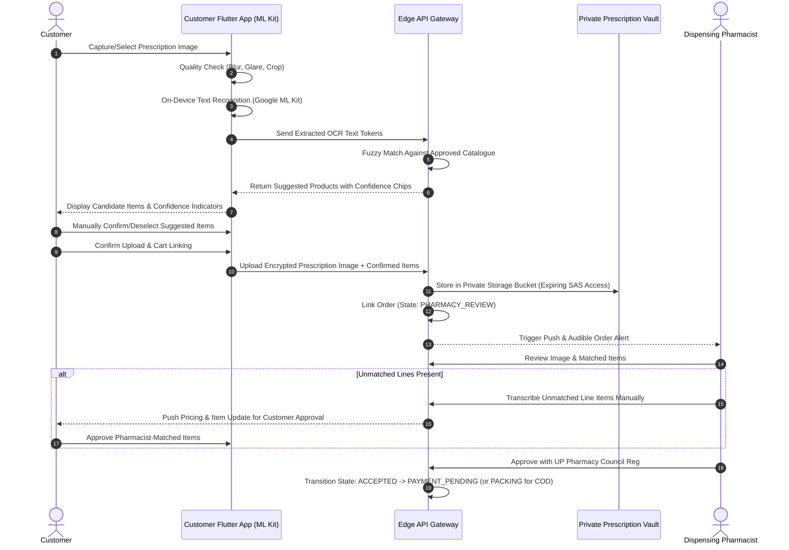
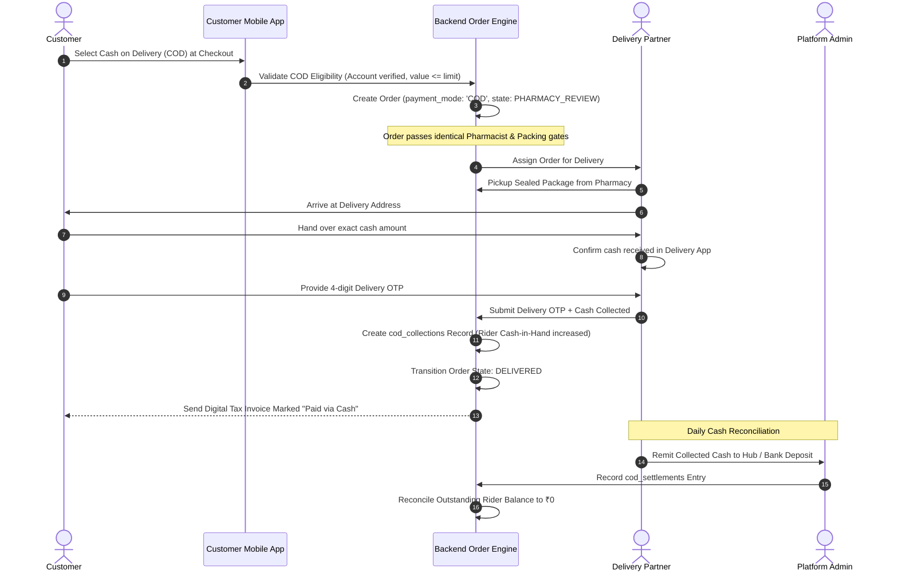
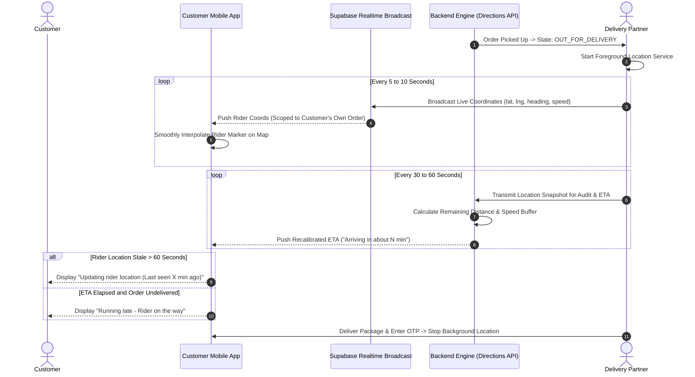

# Medcure: Master Architecture & Product Specification (v2)
**Blinkit-Style Human and Veterinary Quick-Commerce Medicine Delivery Platform**
*Pilot Municipality: Gorakhpur, Uttar Pradesh, India*

---

## 1. System Architecture Diagram (Four Application Surfaces)

```mermaid
flowchart TB
    subgraph Surfaces["Four Application Surfaces (Monorepo)"]
        CA["1. Customer Mobile App<br/>(Flutter Android & iOS)<br/>• Sticky Cart Bar<br/>• On-Device ML Kit OCR<br/>• Live Rider Map & ETA"]
        DA["2. Delivery Partner App<br/>(Flutter - Separate App ID)<br/>• Background Geolocation<br/>• COD Cash Recording<br/>• Delivery OTP Handshake"]
        MA["3. Merchant (Pharmacy) App<br/>(Next.js PWA / Web)<br/>• Web Push & Audible Alert<br/>• Rx Dispensing Review<br/>• Batch Allocation & Seal"]
        AA["4. Admin & Dispatch Station<br/>(Next.js Web Dashboard)<br/>• Full Operational Control<br/>• COD Settlement & Zones<br/>• Immutable Audit Ledger"]
    end

    subgraph EdgeGateway["API Gateway & Security Layer (Supabase / Node.js)"]
        GW["Reverse Proxy / Edge Functions<br/>(JWT Token Validation / Rate Limiting / RFC 7807 Errors)"]
        RT["Supabase Realtime Broadcast<br/>(Ephemeral Rider Geolocation & Order State Pushes)"]
    end

    subgraph ServiceEngines["Core Business Logic Engines"]
        AUTH_SVC["Auth & DLT SMS OTP Service"]
        CAT_SVC["Dual Catalogue & OTC_DIRECT Engine<br/>(Human vs. Veterinary + MRP Checks)"]
        OCR_SVC["Assistive Prescription Reader<br/>(ML Kit On-Device + Server Fuzzy Match)"]
        ORD_SM["Order State Machine & ACID Reservation<br/>(Online & COD Dual Pathways)"]
        ETA_SVC["Dynamic Route & ETA Calculator<br/>(Speed-buffered ETA + Stale Location Monitor)"]
        COD_SVC["COD Ledger & Settlement Engine<br/>(Rider Outstanding Cash Tracking)"]
        AI_SVC["Safe Grounded AI Assistant<br/>(Read-only, Zero Medical Advice Guardrail)"]
    end

    subgraph PersistenceLayer["Persistence & Storage Layer (PostgreSQL 15+ & Storage)"]
        DB[(PostgreSQL Primary<br/>• PostGIS Geo-Zones<br/>• Check Constraint: price <= mrp<br/>• Row-Level Security Enforced)]
        PV_BUCKET["Private Vault Bucket<br/>(Prescriptions & OCR JSON: 15m Expiring SAS)"]
        PUB_BUCKET["Public CDN Bucket<br/>(WebP Product Image Variants)"]
        AUDIT_LOG[(Immutable Audit Trail<br/>Append-Only Ledger)]
    end

    subgraph ExternalIntegrations["External Gateways & Services"]
        PGW["Payment Gateway (Razorpay / Cashfree)<br/>UPI Intent/QR, Cards, Netbanking, Wallets"]
        SMS_GW["DLT Transactional SMS Gateway<br/>(Fast2SMS / MSG91)"]
        MAPS_API["Maps & Routing Provider<br/>(OpenStreetMap / Google Maps)"]
        FCM["Firebase Cloud Messaging<br/>(Silent Data & Visual Push Alerts)"]
        LLM_GW["Gemini Flash API<br/>(Strictly Bound Assistant)"]
    end

    %% Surface to Gateway Connections
    CA -->|HTTPS / WSS| GW
    DA -->|HTTPS / WSS| GW
    MA -->|HTTPS / WSS| GW
    AA -->|HTTPS / WSS| GW

    %% Realtime Connections
    DA -.->|5-10s Geo Broadcast| RT
    RT -.->|Live Rider Coords (Single Order Scope)| CA
    RT -.->|Audible Alerts| MA

    %% Gateway to Engine Routing
    GW --> AUTH_SVC
    GW --> CAT_SVC
    GW --> OCR_SVC
    GW --> ORD_SM
    GW --> ETA_SVC
    GW --> COD_SVC
    GW --> AI_SVC

    %% Engine to DB
    AUTH_SVC --> DB
    CAT_SVC --> DB
    CAT_SVC --> PUB_BUCKET
    OCR_SVC --> DB
    OCR_SVC --> PV_BUCKET
    ORD_SM --> DB
    ORD_SM --> AUDIT_LOG
    ETA_SVC --> DB
    COD_SVC --> DB
    AI_SVC -.->|Read-Only Grounded Search| DB

    %% Integrations
    AUTH_SVC --> SMS_GW
    ORD_SM <--> PGW
    ORD_SM --> FCM
    ETA_SVC --> MAPS_API
    AI_SVC --> LLM_GW
```

---

## 2. Complete Screen Inventory Across Surfaces

### Surface 1: Customer Mobile App (Flutter)
| Screen ID | Title | Blinkit Quick-Commerce Interaction Elements |
|---|---|---|
| **C-01** | Splash & Language | Brand intro, Gorakhpur pilot scope, Hindi/English toggle, minimum necessary permission request (Location/Notifications). |
| **C-02** | Phone Authentication | 10-digit Indian mobile number input, DLT-registered SMS OTP auto-read, failed/expired OTP retry handler, user profile creation. |
| **C-03** | Serviceability & Address | Gorakhpur geofence polygon check (Golghar, BRD Medical College, Betiahata, Mohaddipur), manual PIN entry fallback, out-of-zone alert without false delivery promises. |
| **C-04** | Healthcare Selector | Two large tactile segmented cards: **Human Healthcare** vs. **Animal Healthcare**, global search bar, emergency support banner. |
| **C-05** | Home & Catalogue Rail | Blinkit-style layout: category grid, horizontal product rails, persistent bottom navigation, sticky cart bottom bar with item count & total. Product cards display WebP image, name, brand, pack size, verified price & MRP, three availability badges with text + icon (**In stock**, **Low stock**, **Out of stock**), and Add button that morphs into a quantity stepper (+ / -). Out-of-stock items dim with disabled stepper. `OTC_DIRECT` items tagged for instant ordering; Manual Medicine Request sheet trigger. |
| **C-06** | Product Detail | Image gallery (WebP thumbnails), verified salt/active ingredient, strength, formulation, manufacturer, dispensing partner pharmacy, prescription requirement flag, storage directions. For veterinary products: target species restrictions, meat/milk withdrawal periods, food-producing animal warnings. |
| **C-07** | Prescription Upload & OCR | Camera/gallery picker, file validation, on-device ML Kit OCR scanner, fuzzy-matched candidate medicine list with confidence chips. Customer confirms each matched item before cart insertion; unmatched lines routed to pharmacist transcription. |
| **C-08** | Persistent Cart | Server-side cart, item images, quantity steppers, item-level Rx requirement indicators, transparent subtotal, Gorakhpur delivery fee (free > ₹500), 5% GST breakdown, real-time stock re-validation. Blocked checkout if required prescription is unverified. |
| **C-09** | Checkout & Payments | Address selector, delivery notes, single Indian payment gateway integration (UPI apps: GPay, PhonePe, Paytm, BHIM; Cards, Netbanking, Wallets) + **Cash on Delivery (COD)** toggle. COD fraud check (OTP-verified account, order value limits). |
| **C-10** | Live Tracking & Map | Interactive map rendering partner pharmacy, destination pin, and moving rider position (single-order scoped). Rider first name, vehicle info, masked phone call button. Dynamic ETA timer ("Arriving in about N min", "Running late" fallback if expired, "Updating rider location" if stale > 60s). 4-digit Delivery Handshake OTP card. |
| **C-11** | Order History & Data Rights | Historical orders, itemized tax invoices, prescription archives, cancellation/refund status, DPDP Act data deletion and privacy request controls. |

---

### Surface 2: Delivery Partner Mobile App (Flutter - Separate App ID)
| Screen ID | Title | Interaction Elements |
|---|---|---|
| **D-01** | Rider Duty & Login | Phone OTP authentication, Online/Offline duty toggle, Gorakhpur assigned cluster, today's deliveries, COD cash-in-hand summary. |
| **D-02** | Assigned Order Sheet | Pickup pharmacy address, package ID, sealed bag QR scan verification. **Zero medical/prescription data displayed**. |
| **D-03** | Active Trip Navigation | Live foreground background GPS location broadcaster (throttled 5-10s broadcast, 60s DB snapshot), turn-by-turn navigation handoff, customer virtual phone caller. |
| **D-04** | Proof of Delivery & COD | Customer 4-digit OTP validation, COD cash amount collection confirmation, instant digital receipt generation, failed delivery exception logger. |
| **D-05** | Cash Settlement History | Daily COD cash collected ledger, settlement deposit status, pending remittances to platform dispatch. |

---

### Surface 3: Merchant (Pharmacy) Web App (Next.js PWA)
| Screen ID | Title | Interaction Elements |
|---|---|---|
| **M-01** | Pharmacy Onboarding | Licences submission (Form 20/21), Pharmacist registration certificates, GSTIN, store geo-coordinates, operating hours. |
| **M-02** | Inventory & Batches | Catalogue SKU mapping, selling price (enforced $\le$ MRP), batch numbers, expiry dates, stock reservation ledger, near-expiry alerts, image upload for admin moderation. |
| **M-03** | Incoming Order Stream | Web push and audible siren alert for new orders. Queue categorized into: *Pending Pharmacist Review*, *Ready to Pick*, *Packing*, *Awaiting Rider*. |
| **M-04** | Pharmacist Review Modal | High-resolution prescription viewer, patient age/details, OCR suggested medicines list, Registered Pharmacist council registration number input, decision buttons (*Approve*, *Reject with statutory reason*, *Request Clarification*). |
| **M-05** | Packing & Handover | Physical batch match confirmation, tamper-evident sealed pouch QR generation, rider handover timestamp recorder. |

---

### Surface 4: Platform Admin Dashboard (Next.js Web)
| Screen ID | Title | Interaction Elements |
|---|---|---|
| **A-01** | Executive Command Center | Active order metrics, live rider map, GMV, fulfillment latencies, COD cash outstanding across riders, pharmacy compliance ratings. |
| **A-02** | Pharmacy Verification | Document audit, UP Drug Licensing Authority validation, activation/suspension toggles. |
| **A-03** | Catalogue & Policy Engine | Manage Human & Veterinary catalogues, `OTC_DIRECT` curated allow-list toggles, product image moderation, species withdrawal days, batch recall broadcast. |
| **A-04** | Dispatch & Exceptions | Manual rider assignment, stalled order escalation, COD reconciliation approval, reason-recorded state overrides. |
| **A-05** | Immutable Audit Ledger | Append-only audit events table. Full access to prescription access reasons (strictly audited under DPDP Act), cannot be edited or deleted by any user. |

---

## 3. User Flow Diagrams

### Flow 1: Prescription Upload with On-Device OCR Reader


---

### Flow 2: Cash on Delivery (COD) Order & Cash Settlement Flow


---

### Flow 3: Live Order Tracking with Real-Time Map & Dynamic ETA


---

## 4. Relational Database Schema (40 Tables)

```sql
-- ============================================================================
-- MEDCURE COMPREHENSIVE POSTGRESQL SCHEMA v2 (40 TABLES)
-- Compliant with Drugs & Cosmetics Act 1940, DPDP Act 2023, PostGIS
-- ============================================================================

CREATE EXTENSION IF NOT EXISTS "uuid-ossp";
CREATE EXTENSION IF NOT EXISTS "postgis";

-- 1. DOMAIN ENUMS
DO $$ BEGIN
    CREATE TYPE user_role_enum AS ENUM (
        'customer', 'pharmacy_owner', 'pharmacist', 
        'pharmacy_staff', 'delivery_partner', 'platform_admin', 'support_operator'
    );
    CREATE TYPE healthcare_category_enum AS ENUM ('human', 'veterinary');
    CREATE TYPE prescription_status_enum AS ENUM (
        'uploaded', 'ocr_processed', 'under_review', 'clarification_requested', 'approved', 'rejected', 'expired'
    );
    CREATE TYPE order_state_enum AS ENUM (
        'CREATED', 'PAYMENT_PENDING', 'PAYMENT_CONFIRMED', 'PHARMACY_REVIEW',
        'PRESCRIPTION_CLARIFICATION', 'ACCEPTED', 'REJECTED', 'PACKING',
        'PACKED', 'RIDER_ASSIGNED', 'PICKED_UP', 'OUT_FOR_DELIVERY',
        'DELIVERED', 'CANCELLED', 'DELIVERY_FAILED', 'REFUND_PENDING', 'REFUNDED'
    );
    CREATE TYPE payment_mode_enum AS ENUM ('ONLINE', 'COD');
    CREATE TYPE payment_gateway_enum AS ENUM ('razorpay', 'cashfree', 'cod');
    CREATE TYPE stock_badge_enum AS ENUM ('in_stock', 'low_stock', 'out_of_stock');
EXCEPTION WHEN duplicate_object THEN null;
END $$;

-- 2. USERS & PROFILES
CREATE TABLE IF NOT EXISTS users (
    id UUID PRIMARY KEY DEFAULT uuid_generate_v4(),
    phone VARCHAR(15) UNIQUE NOT NULL,
    email VARCHAR(255),
    full_name VARCHAR(150),
    role user_role_enum NOT NULL DEFAULT 'customer',
    is_active BOOLEAN NOT NULL DEFAULT TRUE,
    created_at TIMESTAMPTZ NOT NULL DEFAULT NOW(),
    updated_at TIMESTAMPTZ NOT NULL DEFAULT NOW()
);

CREATE TABLE IF NOT EXISTS customer_addresses (
    id UUID PRIMARY KEY DEFAULT uuid_generate_v4(),
    user_id UUID NOT NULL REFERENCES users(id) ON DELETE CASCADE,
    address_line1 TEXT NOT NULL,
    address_line2 TEXT,
    landmark VARCHAR(150),
    city VARCHAR(50) NOT NULL DEFAULT 'Gorakhpur',
    state VARCHAR(50) NOT NULL DEFAULT 'Uttar Pradesh',
    pincode VARCHAR(10) NOT NULL,
    latitude DECIMAL(10, 8) NOT NULL,
    longitude DECIMAL(11, 8) NOT NULL,
    is_default BOOLEAN NOT NULL DEFAULT FALSE,
    created_at TIMESTAMPTZ NOT NULL DEFAULT NOW()
);

CREATE TABLE IF NOT EXISTS animal_profiles (
    id UUID PRIMARY KEY DEFAULT uuid_generate_v4(),
    user_id UUID NOT NULL REFERENCES users(id) ON DELETE CASCADE,
    animal_name VARCHAR(100) NOT NULL,
    species VARCHAR(50) NOT NULL,
    breed VARCHAR(100),
    age_years INT,
    weight_kg DECIMAL(6, 2),
    is_food_producing BOOLEAN NOT NULL DEFAULT FALSE,
    allergies TEXT,
    created_at TIMESTAMPTZ NOT NULL DEFAULT NOW()
);

CREATE TABLE IF NOT EXISTS rider_profiles (
    id UUID PRIMARY KEY DEFAULT uuid_generate_v4(),
    user_id UUID UNIQUE NOT NULL REFERENCES users(id) ON DELETE CASCADE,
    vehicle_type VARCHAR(50) NOT NULL DEFAULT 'Two Wheeler',
    vehicle_registration_number VARCHAR(50) NOT NULL,
    driving_licence_number VARCHAR(100) NOT NULL,
    is_available BOOLEAN NOT NULL DEFAULT FALSE,
    current_cash_in_hand DECIMAL(10, 2) NOT NULL DEFAULT 0.00 CHECK (current_cash_in_hand >= 0),
    created_at TIMESTAMPTZ NOT NULL DEFAULT NOW()
);

-- 3. PHARMACIES & LICENCES
CREATE TABLE IF NOT EXISTS pharmacies (
    id UUID PRIMARY KEY DEFAULT uuid_generate_v4(),
    business_name VARCHAR(200) NOT NULL,
    legal_entity_name VARCHAR(200) NOT NULL,
    contact_phone VARCHAR(15) NOT NULL,
    contact_email VARCHAR(150),
    address_line1 TEXT NOT NULL,
    city VARCHAR(50) NOT NULL DEFAULT 'Gorakhpur',
    pincode VARCHAR(10) NOT NULL,
    latitude DECIMAL(10, 8) NOT NULL,
    longitude DECIMAL(11, 8) NOT NULL,
    is_active BOOLEAN NOT NULL DEFAULT FALSE,
    is_verified BOOLEAN NOT NULL DEFAULT FALSE,
    operating_hours JSONB DEFAULT '{"open": "08:00", "close": "22:00"}'::jsonb,
    created_at TIMESTAMPTZ NOT NULL DEFAULT NOW(),
    updated_at TIMESTAMPTZ NOT NULL DEFAULT NOW()
);

CREATE TABLE IF NOT EXISTS pharmacy_licences (
    id UUID PRIMARY KEY DEFAULT uuid_generate_v4(),
    pharmacy_id UUID NOT NULL REFERENCES pharmacies(id) ON DELETE CASCADE,
    licence_type VARCHAR(50) NOT NULL,
    licence_number VARCHAR(100) NOT NULL,
    issued_by VARCHAR(150) NOT NULL,
    valid_from DATE NOT NULL,
    valid_until DATE NOT NULL,
    document_vault_path TEXT NOT NULL,
    is_verified BOOLEAN NOT NULL DEFAULT FALSE,
    verified_by UUID REFERENCES users(id),
    verified_at TIMESTAMPTZ,
    created_at TIMESTAMPTZ NOT NULL DEFAULT NOW()
);

CREATE TABLE IF NOT EXISTS pharmacy_users (
    id UUID PRIMARY KEY DEFAULT uuid_generate_v4(),
    pharmacy_id UUID NOT NULL REFERENCES pharmacies(id) ON DELETE CASCADE,
    user_id UUID NOT NULL REFERENCES users(id) ON DELETE CASCADE,
    pharmacist_reg_number VARCHAR(100),
    reg_council VARCHAR(100),
    created_at TIMESTAMPTZ NOT NULL DEFAULT NOW(),
    UNIQUE(pharmacy_id, user_id)
);

-- 4. PRODUCTS, IMAGES, CATEGORIES & SPECIES
CREATE TABLE IF NOT EXISTS product_categories (
    id UUID PRIMARY KEY DEFAULT uuid_generate_v4(),
    name VARCHAR(100) NOT NULL,
    slug VARCHAR(100) UNIQUE NOT NULL,
    category_domain healthcare_category_enum NOT NULL,
    parent_id UUID REFERENCES product_categories(id),
    icon_url TEXT,
    created_at TIMESTAMPTZ NOT NULL DEFAULT NOW()
);

CREATE TABLE IF NOT EXISTS products (
    id UUID PRIMARY KEY DEFAULT uuid_generate_v4(),
    name VARCHAR(255) NOT NULL,
    brand VARCHAR(150),
    generic_salt_name VARCHAR(255),
    category_id UUID NOT NULL REFERENCES product_categories(id),
    category_domain healthcare_category_enum NOT NULL,
    formulation VARCHAR(100),
    strength VARCHAR(100),
    pack_size VARCHAR(100),
    manufacturer VARCHAR(200),
    mrp DECIMAL(10, 2) NOT NULL CHECK (mrp > 0),
    requires_prescription BOOLEAN NOT NULL DEFAULT FALSE,
    is_otc_direct BOOLEAN NOT NULL DEFAULT FALSE,
    schedule_type VARCHAR(20) DEFAULT 'OTC',
    is_banned_or_recalled BOOLEAN NOT NULL DEFAULT FALSE,
    storage_instructions TEXT,
    created_at TIMESTAMPTZ NOT NULL DEFAULT NOW(),
    updated_at TIMESTAMPTZ NOT NULL DEFAULT NOW(),
    CONSTRAINT chk_otc_direct_safety CHECK (NOT (requires_prescription AND is_otc_direct))
);

CREATE TABLE IF NOT EXISTS product_images (
    id UUID PRIMARY KEY DEFAULT uuid_generate_v4(),
    product_id UUID NOT NULL REFERENCES products(id) ON DELETE CASCADE,
    image_url_thumbnail TEXT NOT NULL,
    image_url_card TEXT NOT NULL,
    image_url_detail TEXT NOT NULL,
    is_primary BOOLEAN NOT NULL DEFAULT FALSE,
    is_moderated BOOLEAN NOT NULL DEFAULT FALSE,
    moderated_by UUID REFERENCES users(id),
    created_at TIMESTAMPTZ NOT NULL DEFAULT NOW()
);

CREATE TABLE IF NOT EXISTS product_restrictions (
    id UUID PRIMARY KEY DEFAULT uuid_generate_v4(),
    product_id UUID NOT NULL REFERENCES products(id) ON DELETE CASCADE,
    restriction_code VARCHAR(50) NOT NULL,
    description TEXT NOT NULL
);

CREATE TABLE IF NOT EXISTS product_species (
    id UUID PRIMARY KEY DEFAULT uuid_generate_v4(),
    product_id UUID NOT NULL REFERENCES products(id) ON DELETE CASCADE,
    species_name VARCHAR(50) NOT NULL,
    withdrawal_period_days INT DEFAULT 0,
    precautions TEXT
);

-- 5. INVENTORY & BATCHES (WITH MRP CONSTRAINT)
CREATE TABLE IF NOT EXISTS pharmacy_inventory (
    id UUID PRIMARY KEY DEFAULT uuid_generate_v4(),
    pharmacy_id UUID NOT NULL REFERENCES pharmacies(id) ON DELETE CASCADE,
    product_id UUID NOT NULL REFERENCES products(id) ON DELETE RESTRICT,
    available_quantity INT NOT NULL DEFAULT 0 CHECK (available_quantity >= 0),
    reserved_quantity INT NOT NULL DEFAULT 0 CHECK (reserved_quantity >= 0),
    mrp DECIMAL(10, 2) NOT NULL,
    selling_price DECIMAL(10, 2) NOT NULL,
    is_available_override BOOLEAN NOT NULL DEFAULT TRUE,
    updated_at TIMESTAMPTZ NOT NULL DEFAULT NOW(),
    UNIQUE(pharmacy_id, product_id),
    CONSTRAINT chk_price_cannot_exceed_mrp CHECK (selling_price <= mrp)
);

CREATE TABLE IF NOT EXISTS inventory_batches (
    id UUID PRIMARY KEY DEFAULT uuid_generate_v4(),
    inventory_id UUID NOT NULL REFERENCES pharmacy_inventory(id) ON DELETE CASCADE,
    batch_number VARCHAR(100) NOT NULL,
    mfg_date DATE NOT NULL,
    expiry_date DATE NOT NULL,
    quantity INT NOT NULL CHECK (quantity >= 0),
    is_quarantined BOOLEAN NOT NULL DEFAULT FALSE,
    created_at TIMESTAMPTZ NOT NULL DEFAULT NOW()
);

-- 6. CARTS (SERVER-SIDE PERSISTENT)
CREATE TABLE IF NOT EXISTS carts (
    id UUID PRIMARY KEY DEFAULT uuid_generate_v4(),
    user_id UUID UNIQUE NOT NULL REFERENCES users(id) ON DELETE CASCADE,
    pharmacy_id UUID REFERENCES pharmacies(id),
    updated_at TIMESTAMPTZ NOT NULL DEFAULT NOW()
);

CREATE TABLE IF NOT EXISTS cart_items (
    id UUID PRIMARY KEY DEFAULT uuid_generate_v4(),
    cart_id UUID NOT NULL REFERENCES carts(id) ON DELETE CASCADE,
    product_id UUID NOT NULL REFERENCES products(id) ON DELETE CASCADE,
    quantity INT NOT NULL CHECK (quantity > 0),
    created_at TIMESTAMPTZ NOT NULL DEFAULT NOW(),
    UNIQUE(cart_id, product_id)
);

-- 7. PRESCRIPTIONS, OCR RESULTS & REVIEWS
CREATE TABLE IF NOT EXISTS prescriptions (
    id UUID PRIMARY KEY DEFAULT uuid_generate_v4(),
    user_id UUID NOT NULL REFERENCES users(id) ON DELETE CASCADE,
    animal_id UUID REFERENCES animal_profiles(id),
    document_vault_path TEXT NOT NULL,
    doctor_name VARCHAR(150),
    registration_number VARCHAR(100),
    status prescription_status_enum NOT NULL DEFAULT 'uploaded',
    created_at TIMESTAMPTZ NOT NULL DEFAULT NOW(),
    updated_at TIMESTAMPTZ NOT NULL DEFAULT NOW()
);

CREATE TABLE IF NOT EXISTS prescription_ocr_results (
    id UUID PRIMARY KEY DEFAULT uuid_generate_v4(),
    prescription_id UUID NOT NULL REFERENCES prescriptions(id) ON DELETE CASCADE,
    raw_extracted_text TEXT NOT NULL,
    extracted_doctor_name VARCHAR(150),
    extracted_reg_number VARCHAR(100),
    extracted_date VARCHAR(50),
    candidate_matches JSONB NOT NULL DEFAULT '[]'::jsonb,
    created_at TIMESTAMPTZ NOT NULL DEFAULT NOW()
);

CREATE TABLE IF NOT EXISTS prescription_reviews (
    id UUID PRIMARY KEY DEFAULT uuid_generate_v4(),
    prescription_id UUID NOT NULL REFERENCES prescriptions(id) ON DELETE CASCADE,
    reviewed_by UUID NOT NULL REFERENCES users(id),
    pharmacist_reg_number VARCHAR(100) NOT NULL,
    decision prescription_status_enum NOT NULL,
    notes TEXT,
    reviewed_at TIMESTAMPTZ NOT NULL DEFAULT NOW()
);

-- 8. ORDERS & FULL FULFILMENT
CREATE TABLE IF NOT EXISTS orders (
    id UUID PRIMARY KEY DEFAULT uuid_generate_v4(),
    order_code VARCHAR(30) UNIQUE NOT NULL,
    user_id UUID NOT NULL REFERENCES users(id) ON DELETE RESTRICT,
    pharmacy_id UUID NOT NULL REFERENCES pharmacies(id) ON DELETE RESTRICT,
    delivery_address_id UUID NOT NULL REFERENCES customer_addresses(id) ON DELETE RESTRICT,
    category_domain healthcare_category_enum NOT NULL,
    payment_mode payment_mode_enum NOT NULL DEFAULT 'ONLINE',
    state order_state_enum NOT NULL DEFAULT 'CREATED',
    total_mrp DECIMAL(10, 2) NOT NULL,
    total_discount DECIMAL(10, 2) NOT NULL DEFAULT 0,
    delivery_fee DECIMAL(10, 2) NOT NULL DEFAULT 0,
    taxes DECIMAL(10, 2) NOT NULL DEFAULT 0,
    payable_amount DECIMAL(10, 2) NOT NULL,
    delivery_otp VARCHAR(6) NOT NULL,
    rejection_reason TEXT,
    created_at TIMESTAMPTZ NOT NULL DEFAULT NOW(),
    updated_at TIMESTAMPTZ NOT NULL DEFAULT NOW()
);

CREATE TABLE IF NOT EXISTS order_items (
    id UUID PRIMARY KEY DEFAULT uuid_generate_v4(),
    order_id UUID NOT NULL REFERENCES orders(id) ON DELETE CASCADE,
    product_id UUID NOT NULL REFERENCES products(id) ON DELETE RESTRICT,
    product_name_snapshot VARCHAR(255) NOT NULL,
    unit_price_snapshot DECIMAL(10, 2) NOT NULL,
    quantity INT NOT NULL CHECK (quantity > 0),
    batch_number_assigned VARCHAR(100),
    expiry_date_assigned DATE
);

CREATE TABLE IF NOT EXISTS prescription_order_links (
    id UUID PRIMARY KEY DEFAULT uuid_generate_v4(),
    order_id UUID NOT NULL REFERENCES orders(id) ON DELETE CASCADE,
    prescription_id UUID NOT NULL REFERENCES prescriptions(id) ON DELETE RESTRICT,
    created_at TIMESTAMPTZ NOT NULL DEFAULT NOW(),
    UNIQUE(order_id, prescription_id)
);

CREATE TABLE IF NOT EXISTS medicine_requests (
    id UUID PRIMARY KEY DEFAULT uuid_generate_v4(),
    user_id UUID NOT NULL REFERENCES users(id) ON DELETE CASCADE,
    pharmacy_id UUID NOT NULL REFERENCES pharmacies(id) ON DELETE CASCADE,
    medicine_name VARCHAR(200) NOT NULL,
    status VARCHAR(50) NOT NULL DEFAULT 'submitted',
    quoted_price DECIMAL(10, 2),
    created_at TIMESTAMPTZ NOT NULL DEFAULT NOW()
);

-- 9. DELIVERIES, REAL-TIME TRACKING & COD SETTLEMENT
CREATE TABLE IF NOT EXISTS deliveries (
    id UUID PRIMARY KEY DEFAULT uuid_generate_v4(),
    order_id UUID UNIQUE NOT NULL REFERENCES orders(id) ON DELETE CASCADE,
    rider_id UUID REFERENCES users(id),
    status VARCHAR(50) NOT NULL DEFAULT 'unassigned',
    assigned_at TIMESTAMPTZ,
    picked_up_at TIMESTAMPTZ,
    delivered_at TIMESTAMPTZ,
    created_at TIMESTAMPTZ NOT NULL DEFAULT NOW()
);

CREATE TABLE IF NOT EXISTS delivery_events (
    id UUID PRIMARY KEY DEFAULT uuid_generate_v4(),
    delivery_id UUID NOT NULL REFERENCES deliveries(id) ON DELETE CASCADE,
    event_name VARCHAR(100) NOT NULL,
    latitude DECIMAL(10, 8),
    longitude DECIMAL(11, 8),
    notes TEXT,
    created_at TIMESTAMPTZ NOT NULL DEFAULT NOW()
);

CREATE TABLE IF NOT EXISTS rider_location_snapshots (
    id UUID PRIMARY KEY DEFAULT uuid_generate_v4(),
    rider_id UUID NOT NULL REFERENCES users(id) ON DELETE CASCADE,
    order_id UUID REFERENCES orders(id) ON DELETE CASCADE,
    latitude DECIMAL(10, 8) NOT NULL,
    longitude DECIMAL(11, 8) NOT NULL,
    heading DECIMAL(5, 2),
    speed_kmh DECIMAL(5, 2),
    recorded_at TIMESTAMPTZ NOT NULL DEFAULT NOW()
);

CREATE TABLE IF NOT EXISTS eta_logs (
    id UUID PRIMARY KEY DEFAULT uuid_generate_v4(),
    order_id UUID NOT NULL REFERENCES orders(id) ON DELETE CASCADE,
    predicted_eta_minutes INT NOT NULL,
    actual_duration_minutes INT,
    recorded_at TIMESTAMPTZ NOT NULL DEFAULT NOW()
);

CREATE TABLE IF NOT EXISTS delivery_zones (
    id UUID PRIMARY KEY DEFAULT uuid_generate_v4(),
    zone_name VARCHAR(100) NOT NULL,
    city VARCHAR(50) NOT NULL DEFAULT 'Gorakhpur',
    boundary_geom GEOMETRY(Polygon, 4326) NOT NULL,
    base_delivery_fee DECIMAL(10, 2) NOT NULL DEFAULT 25.00,
    free_delivery_threshold DECIMAL(10, 2) NOT NULL DEFAULT 500.00,
    is_active BOOLEAN NOT NULL DEFAULT TRUE
);

-- 10. PAYMENTS, COD COLLECTIONS & SETTLEMENTS
CREATE TABLE IF NOT EXISTS payments (
    id UUID PRIMARY KEY DEFAULT uuid_generate_v4(),
    order_id UUID NOT NULL REFERENCES orders(id) ON DELETE RESTRICT,
    gateway payment_gateway_enum NOT NULL DEFAULT 'razorpay',
    gateway_order_id VARCHAR(150),
    gateway_payment_id VARCHAR(150),
    amount DECIMAL(10, 2) NOT NULL,
    currency VARCHAR(5) DEFAULT 'INR',
    status VARCHAR(50) NOT NULL DEFAULT 'initiated',
    idempotency_key VARCHAR(150) UNIQUE NOT NULL,
    signature_verified BOOLEAN NOT NULL DEFAULT FALSE,
    payload JSONB,
    created_at TIMESTAMPTZ NOT NULL DEFAULT NOW()
);

CREATE TABLE IF NOT EXISTS payment_method_settings (
    id UUID PRIMARY KEY DEFAULT uuid_generate_v4(),
    method_name VARCHAR(50) UNIQUE NOT NULL,
    is_enabled BOOLEAN NOT NULL DEFAULT TRUE,
    max_order_limit DECIMAL(10, 2) DEFAULT 5000.00,
    updated_by UUID REFERENCES users(id),
    updated_at TIMESTAMPTZ NOT NULL DEFAULT NOW()
);

CREATE TABLE IF NOT EXISTS cod_collections (
    id UUID PRIMARY KEY DEFAULT uuid_generate_v4(),
    order_id UUID UNIQUE NOT NULL REFERENCES orders(id) ON DELETE RESTRICT,
    rider_id UUID NOT NULL REFERENCES users(id) ON DELETE RESTRICT,
    amount_collected DECIMAL(10, 2) NOT NULL CHECK (amount_collected > 0),
    receipt_number VARCHAR(100) UNIQUE NOT NULL,
    collected_at TIMESTAMPTZ NOT NULL DEFAULT NOW()
);

CREATE TABLE IF NOT EXISTS cod_settlements (
    id UUID PRIMARY KEY DEFAULT uuid_generate_v4(),
    rider_id UUID NOT NULL REFERENCES users(id) ON DELETE RESTRICT,
    amount_deposited DECIMAL(10, 2) NOT NULL CHECK (amount_deposited > 0),
    deposit_reference VARCHAR(150) NOT NULL,
    verified_by UUID NOT NULL REFERENCES users(id),
    settled_at TIMESTAMPTZ NOT NULL DEFAULT NOW()
);

CREATE TABLE IF NOT EXISTS refunds (
    id UUID PRIMARY KEY DEFAULT uuid_generate_v4(),
    order_id UUID NOT NULL REFERENCES orders(id) ON DELETE RESTRICT,
    amount DECIMAL(10, 2) NOT NULL,
    reason TEXT NOT NULL,
    gateway_refund_id VARCHAR(150),
    status VARCHAR(50) NOT NULL DEFAULT 'pending',
    created_at TIMESTAMPTZ NOT NULL DEFAULT NOW()
);

-- 11. NOTIFICATIONS, FEATURE FLAGS & AUDIT TRAIL
CREATE TABLE IF NOT EXISTS support_tickets (
    id UUID PRIMARY KEY DEFAULT uuid_generate_v4(),
    user_id UUID NOT NULL REFERENCES users(id) ON DELETE CASCADE,
    order_id UUID REFERENCES orders(id),
    subject VARCHAR(200) NOT NULL,
    status VARCHAR(50) NOT NULL DEFAULT 'open',
    priority VARCHAR(20) NOT NULL DEFAULT 'medium',
    assigned_to UUID REFERENCES users(id),
    created_at TIMESTAMPTZ NOT NULL DEFAULT NOW()
);

CREATE TABLE IF NOT EXISTS notifications (
    id UUID PRIMARY KEY DEFAULT uuid_generate_v4(),
    user_id UUID NOT NULL REFERENCES users(id) ON DELETE CASCADE,
    title VARCHAR(150) NOT NULL,
    body TEXT NOT NULL,
    data JSONB,
    is_read BOOLEAN NOT NULL DEFAULT FALSE,
    created_at TIMESTAMPTZ NOT NULL DEFAULT NOW()
);

CREATE TABLE IF NOT EXISTS device_tokens (
    id UUID PRIMARY KEY DEFAULT uuid_generate_v4(),
    user_id UUID NOT NULL REFERENCES users(id) ON DELETE CASCADE,
    fcm_token TEXT NOT NULL,
    device_os VARCHAR(20),
    updated_at TIMESTAMPTZ NOT NULL DEFAULT NOW()
);

CREATE TABLE IF NOT EXISTS feature_flags (
    key VARCHAR(100) PRIMARY KEY,
    is_enabled BOOLEAN NOT NULL DEFAULT FALSE,
    description TEXT,
    updated_at TIMESTAMPTZ NOT NULL DEFAULT NOW()
);

CREATE TABLE IF NOT EXISTS audit_events (
    id UUID PRIMARY KEY DEFAULT uuid_generate_v4(),
    actor_id UUID REFERENCES users(id),
    action VARCHAR(100) NOT NULL,
    resource_type VARCHAR(100) NOT NULL,
    resource_id UUID NOT NULL,
    old_state JSONB,
    new_state JSONB,
    access_reason TEXT,
    ip_address VARCHAR(50),
    created_at TIMESTAMPTZ NOT NULL DEFAULT NOW()
);

CREATE TABLE IF NOT EXISTS ai_sessions (
    id UUID PRIMARY KEY DEFAULT uuid_generate_v4(),
    user_id UUID REFERENCES users(id),
    session_context VARCHAR(100) NOT NULL,
    prompt_tokens INT DEFAULT 0,
    completion_tokens INT DEFAULT 0,
    created_at TIMESTAMPTZ NOT NULL DEFAULT NOW()
);

-- CORE PERFORMANCE INDEXES
CREATE INDEX IF NOT EXISTS idx_products_search ON products USING gin(to_tsvector('english', name || ' ' || COALESCE(generic_salt_name, '') || ' ' || COALESCE(brand, '')));
CREATE INDEX IF NOT EXISTS idx_products_category ON products(category_id, category_domain);
CREATE INDEX IF NOT EXISTS idx_inventory_pharmacy ON pharmacy_inventory(pharmacy_id, product_id);
CREATE INDEX IF NOT EXISTS idx_orders_user ON orders(user_id, state);
CREATE INDEX IF NOT EXISTS idx_orders_pharmacy ON orders(pharmacy_id, state);
CREATE INDEX IF NOT EXISTS idx_rider_loc_time ON rider_location_snapshots(order_id, recorded_at DESC);
CREATE INDEX IF NOT EXISTS idx_audit_resource ON audit_events(resource_type, resource_id);
```

---

## 5. API Contract (`/api/v1`)

| Endpoint | Method | Role / Auth | Request Payload / Params | Response (200 / 201) |
|---|:---:|:---:|---|---|
| `/auth/request-otp` | `POST` | Public | `{"phone": "+919876500006"}` | `{"session_id": "...", "expires_in": 300}` |
| `/auth/verify-otp` | `POST` | Public | `{"session_id": "...", "otp": "1234"}` | `{"token": "jwt", "user": {...}}` |
| `/serviceability/check` | `GET` | Public | `?lat=26.7606&lng=83.3732` | `{"is_serviceable": true, "zone": "Golghar"}` |
| `/catalogue/products` | `GET` | Public | `?domain=human&lat=26.76&lng=83.37` | `{"items": [{"id": "...", "stock_badge": "in_stock", "is_otc_direct": true, ...}]}` |
| `/prescriptions/upload-intent` | `POST` | Customer | `{"fileName": "rx.jpg"}` | `{"prescription_id": "...", "upload_url": "..."}` |
| `/prescriptions/:id/ocr` | `POST` | Customer | `{"extracted_text": "Tab Glycomet 500mg"}` | `{"candidate_matches": [{"product_id": "...", "confidence": 0.94}]}` |
| `/cart` | `GET` | Customer | Bearer Auth | `{"items": [...], "subtotal": 216, "delivery_fee": 25}` |
| `/cart/items` | `POST` | Customer | `{"product_id": "...", "quantity": 1}` | `{"cart": {...}}` |
| `/orders` | `POST` | Customer | `{"pharmacy_id": "...", "payment_mode": "COD", "items": [...]}` | `{"order_id": "...", "state": "PHARMACY_REVIEW"}` |
| `/orders/:id/track` | `GET` | Customer (Own) | Bearer Auth | `{"state": "OUT_FOR_DELIVERY", "eta_minutes": 12, "rider": {"first_name": "Vikas"}}` |
| `/rider/location-update` | `POST` | Rider | `{"order_id": "...", "lat": 26.76, "lng": 83.37, "speed": 22.4}` | `{"status": "broadcast_sent"}` |
| `/pharmacy/orders/:id/review-prescription` | `POST` | Pharmacist | `{"decision": "approved", "pharmacist_reg_number": "UP-PCR-78421"}` | `{"success": true, "state": "ACCEPTED"}` |
| `/pharmacy/orders/:id/pack` | `POST` | Staff / Owner | `{"batch_number": "B129", "expiry_date": "2027-02-28"}` | `{"success": true, "state": "PACKED"}` |
| `/rider/orders/:id/complete-delivery` | `POST` | Rider | `{"delivery_otp": "7482", "cash_collected": 241.00}` | `{"success": true, "state": "DELIVERED"}` |
| `/admin/cod/reconciliation` | `GET` | Admin | Bearer Auth | `{"outstanding_cash_by_rider": [...]}` |
| `/admin/audit-logs` | `GET` | Admin | `?resource_type=prescription` | `{"audit_trail": [...]}` |
| `/ai/chat` | `POST` | Auth Customer | `{"prompt": "Where is my order?"}` | `{"message": "...", "disclaimer": "..."}` |

---

## 6. Server-Enforced RBAC Permission Matrix

| Resource & Action | Customer | Pharmacy Owner | Dispensing Pharmacist | Pharmacy Staff | Delivery Partner | Platform Admin | Support Operator |
|---|:---:|:---:|:---:|:---:|:---:|:---:|:---:|
| Browse Catalogue & Availability | ✅ | ✅ | ✅ | ✅ | ✅ | ✅ | ✅ |
| Add `OTC_DIRECT` to Cart | ✅ | ❌ | ❌ | ❌ | ❌ | ❌ | ❌ |
| Upload & View Own Prescription | ✅ (Own) | ❌ | ❌ | ❌ | ❌ | ❌ | ❌ |
| View Unmasked Prescription File | ✅ (Own) | ✅ (Own store) | ✅ (Full) | ❌ | ❌ (Strictly Blocked) | ⚠️ (Requires Stated Reason) | ❌ (Blocked) |
| Approve / Reject Prescription | ❌ | ❌ | ✅ (Council Reg Required) | ❌ | ❌ | ❌ (Cannot override) | ❌ |
| Update Inventory & Pricing (<= MRP) | ❌ | ✅ | ✅ | ❌ | ❌ | ✅ (Emergency Recall) | ❌ |
| Pack & Allocate Batch Details | ❌ | ✅ | ✅ | ✅ | ❌ | ❌ | ❌ |
| Share Live Rider Geolocation | ❌ | ❌ | ❌ | ❌ | ✅ (Active delivery only) | ❌ | ❌ |
| View Live Rider Map & ETA | ✅ (Own active order) | ❌ | ❌ | ❌ | ❌ | ✅ (Live fleet view) | ✅ (Assigned ticket) |
| Collect COD Cash & Submit OTP | ❌ | ❌ | ❌ | ❌ | ✅ | ❌ | ❌ |
| Reconcile Rider COD Cash Deposit | ❌ | ❌ | ❌ | ❌ | ❌ | ✅ | ❌ |
| Manual Order State Override | ❌ | ❌ | ❌ | ❌ | ❌ | ⚠️ (Reason Recorded) | ❌ |
| Edit or Delete Audit Trail | ❌ | ❌ | ❌ | ❌ | ❌ | ❌ (IMPOSSIBLE) | ❌ (IMPOSSIBLE) |

---

## 7. Payment-Method Matrix

| Payment Method | Gateway Provider | Sub-Channels Enabled | Merchant Account Status | Fallback / COD Rules |
|---|---|---|---|---|
| **UPI Intent & QR** | Razorpay / Cashfree | Google Pay, PhonePe, Paytm, BHIM, Navi, Cred, Amazon Pay | Auto-enabled via Gateway UPI Rail | Fallback to Web UPI Collect |
| **Debit & Credit Cards** | Razorpay / Cashfree | Visa, MasterCard, RuPay, Maestro | Merchant KYC approved | 3D-Secure OTP required |
| **Netbanking** | Razorpay / Cashfree | 50+ Indian Banks (SBI, HDFC, ICICI, PNB, BoB) | Native Gateway redirect | Standard session timeout |
| **Digital Wallets** | Razorpay / Cashfree | Amazon Pay, Mobikwik, Airtel Money | Enabled if merchant toggle active | Tokenized balance check |
| **Cash on Delivery (COD)** | Platform Native Engine | Physical Currency Handover to Rider | Admin configurable toggle per zone | Order cap: ₹2,000; OTP verified accounts; OTP handshake mandatory |

---

## 8. Regulatory & Operational Risk Register

| Risk ID | Domain | Risk Description | Severity | Mitigation & Technical Safeguard |
|---|---|---|:---:|---|
| **R-01** | Drugs Act 1940 | Dispensing Schedule H/H1 drugs without prescription under e-pharmacy scrutiny. | **CRITICAL** | Automated checkout block; on-device OCR cannot auto-approve; dispensing locked until Registered Pharmacist logs State Pharmacy Council registration number. |
| **R-02** | Consumer Protection | Pharmacy listing selling price higher than printed Maximum Retail Price (MRP). | **HIGH** | PostgreSQL database-level check constraint: `CONSTRAINT chk_price_cannot_exceed_mrp CHECK (selling_price <= mrp)`. |
| **R-03** | Veterinary Food Safety | Cattle milk/meat contamination from antibiotic bolus without withdrawal warning. | **HIGH** | Product cards and printed invoices display mandatory `withdrawal_period_days`; food-producing animal profile warnings. |
| **R-04** | DPDP Act 2023 | Leakage of customer health prescriptions or unrestricted administrative access. | **CRITICAL** | Private cloud storage bucket with zero public URLs; 15-minute SAS tokens; administrative access requires stated business justification recorded in append-only audit trail. |
| **R-05** | Financial / COD | Delivery partner cash withholding or false non-delivery disputes. | **HIGH** | Maximum COD limit (₹2,000); every collection generates a `cod_collections` record; daily rider cash reconciliation; customer delivery OTP handshake required. |
| **R-06** | AI Liability | AI assistant hallucinating dosages or recommending off-label human use of animal drugs. | **CRITICAL** | Prompt boundary filter blocks medical queries, dosage calculations, and drug substitutions with an immediate referral to registered practitioners. |
| **R-07** | Rider Safety / Privacy | Background tracking draining rider battery or leaking location when off-duty. | **MEDIUM** | Android foreground service runs exclusively during active delivery trip; location sharing terminates upon delivery closure. |

---

## 9. Cost & Deployment Plan (Three Scenarios)

### Scenario A: Strictly Free-Tier (Zero Cloud Cost)
*Best for local development, staging tests, and internal demonstration.*

| Service | Tier / Quota | Monthly Cost (INR) |
|---|---|:---:|
| **Supabase** | Free Hobby (500MB DB, 1GB Storage, 200 Realtime connections) | ₹0 |
| **Vercel** | Free Hobby (Frontend PWA & Admin Dashboard hosting) | ₹0 |
| **Firebase Cloud Messaging** | Free Tier (FCM push notifications) | ₹0 |
| **Google ML Kit** | On-Device Text Recognition (zero server API calls) | ₹0 |
| **Payment Gateway Sandbox** | Razorpay / Cashfree Test Mode | ₹0 |
| **Mapping Tiles** | OpenStreetMap / MapLibre (Self-hosted or free tile providers) | ₹0 |
| **Total Scenario A** | | **₹0 / month** |

*Limitations:* 500MB DB ceiling; 200 concurrent Realtime connections; test SMS only (no real phone OTP).

---

### Scenario B: Realistic Pilot (Target Budget < ₹25,000 INR)
*Optimized for a 60-day Gorakhpur pilot covering 2 partner pharmacies, 5 riders, and ~1,000 orders.*

| Item | Specification / Provider | Estimated Cost (INR) |
|---|---|:---:|
| **Domain & SSL** | 1-year `.in` domain on Cloudflare | ₹950 |
| **DLT Registration & SMS OTP** | DLT Principal Entity registration (TRAI) + 2,500 transactional OTP SMS | ₹2,500 |
| **Google Maps Platform** | $200 monthly free credit (sufficient for Gorakhpur pilot volume) | ₹0 |
| **Gemini AI API** | Pay-as-you-go Gemini 1.5/2.0 Flash (< 100,000 tokens) | ₹250 |
| **Payment Gateway** | Live transaction fee (2% per online transaction absorbed in GMV) | ₹0 |
| **Tamper-Evident Delivery Pouches** | 500 Security-seal courier bags with sequential barcode seals | ₹4,500 |
| **Local Legal & Regulatory Counsel** | Gorakhpur drug retail aggregation legal review | ₹12,000 |
| **Operational Contingency** | Buffer for pilot testing fuel and materials | ₹4,800 |
| **Total Scenario B** | | **₹25,000** |

---

### Scenario C: Growth Scale (Post-Validation Scale)
*For 500+ daily orders across Eastern Uttar Pradesh.*

| Service | Provider & Tier | Estimated Cost (INR) |
|---|---|:---:|
| **Database & Realtime** | Supabase Pro ($25/mo - 8GB DB, 100GB Storage, 500 concurrent connections) | ~₹2,100 / mo |
| **Web Hosting** | Vercel Pro ($20/mo per seat) | ~₹1,680 / mo |
| **SMS Gateway** | High-throughput DLT SMS Pool (20,000 OTPs) | ~₹3,500 / mo |
| **Server-Side OCR Fallback** | Google Cloud Vision API ($1.50 per 1,000 requests) | ~₹1,250 / mo |
| **Google Maps Directions API** | High-frequency route calculations | ~₹4,500 / mo |
| **Google Play & Apple Developer** | Google Play ($25 one-time) + Apple Developer ($99/year) | ~₹10,500 (Year 1) |
| **Total Scenario C** | | **~₹13,000 / month + App Store fees** |
